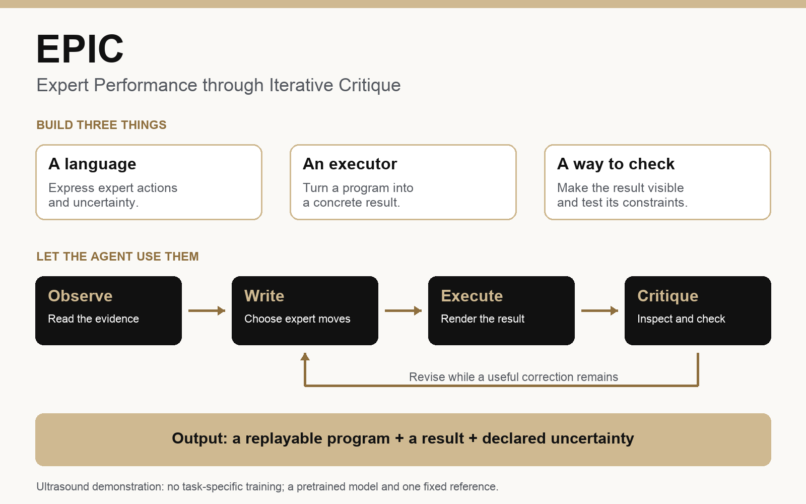

# EPIC: Expert Performance through Iterative Critique

**A pattern for building AI agents that work the way experts work: with a small language of expert
moves, tools that carry those moves out, and views that let the agent criticise its own result and
correct it.**

> The story behind this repository is told in the Substack post
> **"EPIC: A pattern for expert action"** (*link coming soon*: `SUBSTACK_POST_URL`).

## The idea

Ask an expert to outline a heart in an ultrasound image, lay out a circuit, or tune a schedule, and
they will not produce the answer in one stroke. They make a move they know ("move the apex up a
little", "widen the wall"), look at the result, and correct it, again and again, until nothing worth
correcting is left. Sometimes they say: I cannot do better than this.

EPIC gives an AI agent the same working conditions. You build three things:

1. **A language** for the expert's moves. Not pixels or raw parameters, but the actions an expert
   would name, with units, which combine into a short program.
2. **An executor** that turns a program into a result and enforces the rules that must always hold.
   A move that would break one is refused, with the reason.
3. **A critic** that shows the result the way an expert looks at it: renderings, measurements,
   reference examples, constraint checks, and the instruction for how to judge.

Then you let the agent loop: **observe, write a program, execute, critique, revise**, until it finds
nothing it can correct with confidence, or decides it cannot do the task. What it hands in is a
program and its result, which a person can read line by line, replay, and correct.

Five steps put the pattern together:

1. Choose the object the expert works on.
2. Name the useful expert moves; constrain their combinations.
3. Build the tools that actually carry out those moves.
4. Return the result, constraint checks, and useful views for inspection.
5. Turn criticism into the next edit; allow stopping or abstention.

No model is trained. The knowledge lives in the model, the reference examples, the language and the
checks.

## How to build one

The full procedure, written as instructions an agent can follow, is in **[`EPIC.md`](EPIC.md)**.
In short:

### 1. Pick a benchmark you can score

Before building anything, find cases with expert answers and a score that experts already use, so
that published expert-to-expert agreement tells you what "good" means. Split the cases into a few
reference examples, a development set, and a held-out set you will not open until the end. Write
the scorer, and compute reference points: the score of doing nothing, of a simple automatic method,
and of a program fitted to the answer (which tells you whether your language can express the answer
at all).

### 2. Build a baseline EPIC system

Build the simplest working version of each part: a handful of moves, an executor with its guards and
clear refusal messages, the critic's views and a short report, an agent guide with a stopping rule,
and a harness that runs one blind agent per case, audits every tool call and scores the result. Run
it on the development cases, then **run it again** on the same cases: the difference between the two
runs is your noise floor.

### 3. Improve it with autoresearch

Run an autoresearch loop, the kind in which an agent edits code, runs a fixed experiment and keeps a
change only if the score improves, with the EPIC system itself as the thing being edited:

- the **language**, when the agent sees the problem but cannot express the fix;
- the **executor**, when valid intentions are refused or results come out invalid;
- the **critic**, when the agent does not see an error, misreads a view, or stops at the wrong time.

The benchmark and the scorer are read-only. One change per experiment, a decision rule written
before the run, and a change kept only if it beats the noise floor. Cheap probes help decide where to
look: fit the language to the answers (is the language the limit?), and plant known errors for the
agent to find (what size of error can it see?).

### 4. Test once on held-out cases

Write the protocol and thresholds first, freeze the system, run once, audit, and report against the
protocol, including what was not met.

## Example: outlining the heart in ultrasound

[`examples/ultrasound/`](examples/ultrasound/) is a complete worked example. The agent deforms one
cardiologist's tracing onto each new image by writing a short program in *phi-script*, a language in
which every program is a smooth, invertible deformation, so outlines can bend but never tear or
cross. It reads its result in views a cardiologist would use and corrects it.

On 40 held-out images, with no training, the agent's outlines overlap the cardiologist's with a mean
Dice of 0.85 for the cavity, 0.90 for the ventricle with its wall and 0.84 for the atrium: between two
other cardiologists, below the same cardiologist's repeat tracing and a network trained on 400
patients. The example also records what the improvement rounds changed, three ideas that did not help,
and what it costs (about $3.50 to $5 per image).

The lesson that matters most for anyone building an EPIC system: the language was not the limit
(fitted to the answers, it reaches 0.99); what the agent could *see* was. Spend the improvement
effort on the critic, and measure every gain against how much two identical runs differ.

## Repository

| Path | For | What |
|---|---|---|
| [`README.md`](README.md) | people | This overview |
| [`EPIC.md`](EPIC.md) | agents | The pattern and the build procedure, as instructions |
| [`AGENTS.md`](AGENTS.md) | agents | Points agents working in this repository to `EPIC.md` |
| [`examples/ultrasound/`](examples/ultrasound/) | both | The worked example: language, an agent's program and notes, results |

## Citation

If you use the pattern, please cite the Substack post (`SUBSTACK_POST_URL`) and this repository.
The ultrasound example uses the CAMUS dataset (Leclerc et al., IEEE TMI 2019; CC BY-NC-SA 4.0).

## License

MIT, see [`LICENSE`](LICENSE). Results derived from CAMUS remain under the dataset's licence.
