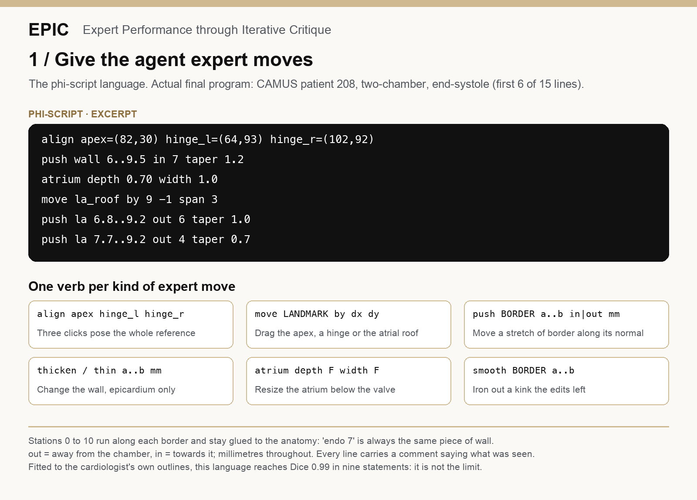
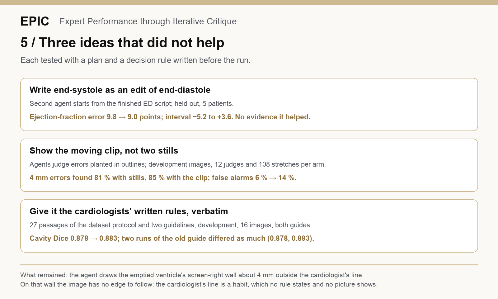
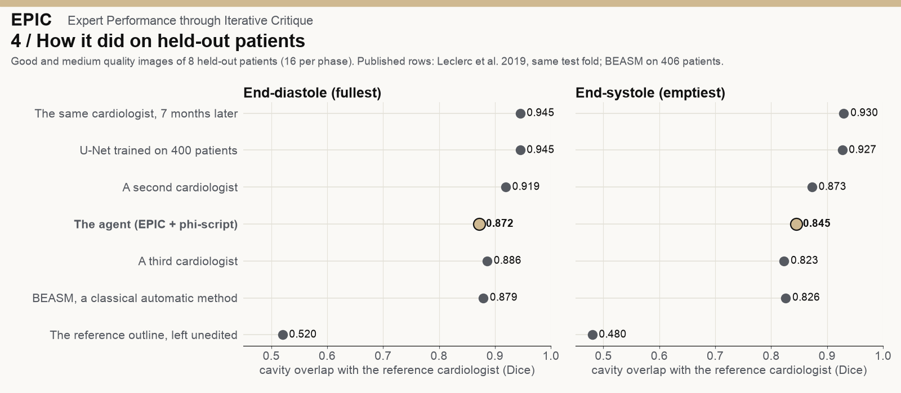

# Example: outlining the heart in cardiac ultrasound

An EPIC system that outlines the left ventricle, its wall and the left atrium on one frame of an
apical cardiac ultrasound recording, the way a cardiologist traces them, with no task-specific
training. Built and run with Claude (Fable 5.2) as the agent, on the public CAMUS dataset.

Each part of the pattern ([`EPIC.md`](../../EPIC.md)) has a counterpart here.

## The task

| EPIC part | In this example |
|---|---|
| **Object** | Three open curves: the cavity border (endocardium), the outer border of the muscle (epicardium), and the left atrium, plus three landmarks (apex and two valve hinges). |
| **Starting point** | One cardiologist's tracing of one other patient (four-chamber view, end-diastole), the same for every image, view and phase. |
| **Language** | *phi-script*: `align`, `move`, `push`, `offset`, `thicken`/`thin`, `smooth`, `atrium`, and whole-picture affine moves. See [`LANGUAGE.md`](LANGUAGE.md). |
| **Executor** | Compiles each statement to an affine map or certified kernel steps, so the composition φ is a diffeomorphism by construction; refuses a statement that would make borders cross or fold, with the reason. |
| **Critic** | After each run: an overview (image alone and with borders), magnified cards of the three landmarks, each border "unrolled" into a strip with a millimetre ruler, a report of what each statement did with sizes and wall thickness next to twelve clinician examples, a probe of intensity steps (advice only), and an "ask an expert" tool (nobody was connected). |
| **Agent** | One agent per image, blind to the patient, the image quality and every answer. Budget about 25 runs of its script. |
| **Stopping rule** | "Stop when a full pass over the three strips, the overview and the cards shows nothing visible that is more than about 1.5 mm off, or when you have used your budget." |
| **Hand-in** | The program, every line commented with what was seen, and a notes file: confidence in each landmark, what was visible where, the error it expects, remaining doubts. Example: [`files/example_program.phi`](files/example_program.phi), [`files/example_notes.json`](files/example_notes.json). |

## Phase A: the benchmark

- **Data:** CAMUS (Leclerc et al., IEEE TMI 2019), apical two- and four-chamber frames at end-diastole
  and end-systole, each traced by the same cardiologist. Licence CC BY-NC-SA 4.0.
- **Score:** Dice overlap with the cardiologist's tracing for each structure, mean and largest
  border distance in mm, and the ejection fraction from the biplane volumes.
- **Yardsticks** from the dataset paper, on the same test fold: a second and a third cardiologist
  against the reference cardiologist, the same cardiologist redrawing seven months later, a U-Net
  trained on 400 patients, and a classical automatic method.
- **Splits:** 12 frames of 6 training patients as examples; 12 further training patients for
  development; the official test fold as held-out, used in a fixed seeded order a few patients at a
  time.
- **Reference points:** the reference outline left unedited (cavity Dice 0.52 at end-diastole),
  the cardiologist's own three landmarks with the reference shape (0.91 on development images), and
  a script fitted to the cardiologist's outline by optimisation (Dice 0.99 in nine statements: the
  language can express the answer).

## Phase B: the baseline

Built as described in phase B, with a written protocol, blind work directories under opaque ids, an
allow-list audit of every tool call, and a hash of every file the agents can read.

On development images the first version reached cavity / wall / atrium Dice 0.89 / 0.87 / 0.77 on
six images.

## Phase C: improvement rounds

The improvement in this example was done in development rounds run by hand, with the same logic as
the autoresearch loop of [`EPIC.md`](../../EPIC.md): one failure, the part of the system it points to,
one change, a rerun on development images. What the rounds changed, by part:

| Part | Change | Why |
|---|---|---|
| Critic (instructions) | Defined the apex as the far tip of the long axis, not the highest point of the cavity, and drew the long axis on the pictures | Every agent put the apex 4 to 11 mm off; the definition halved the error |
| Critic (report) | Printed the cardiologist's wall thickness and axis tilts from the examples next to the agent's, flagged departures from these habits, and did *not* flag sizes | Agents drew walls 5 to 8 mm too thin; epicardium Dice rose from 0.87 to 0.92. A version that flagged sizes made agents stretch small hearts |
| Language | Added `smooth` | Short pushes left kinks the cardiologist never draws |
| Executor | Refused edits that would fold or crumple an outline | Some edits produced outlines no heart has |

After the first two changes the system scored 0.90 / 0.92 / 0.81 on twelve development images
(three agents each). The last two were added after that, and this version was frozen for the
held-out test.

Later experiments, each with a plan and a decision rule written before the run, did **not** help:

- writing the end-systolic outline as an edit of the finished end-diastolic one (held-out, five
  patients: ejection-fraction error 9.8 and 9.0 points; no evidence of a gain);
- showing the moving clip instead of two still frames (planted 4 mm errors found 81 % and 85 % of
  the time; false alarms rose from 6 % to 14 %);
- giving the agent the cardiologists' written rules verbatim, in place of the guide's restatement
  (cavity Dice 0.878 and 0.883 on 16 development images; two runs of the old guide differed as much).

## Phase D: the held-out test

Ten patients, 40 images, one agent per image, the protocol and thresholds fixed before any held-out
image was opened.

- Cavity Dice 0.85, ventricle with its wall 0.90, atrium 0.84; borders 3 to 4 mm from the
  cardiologist's on average.
- On good and medium quality images: 0.872 at end-diastole and 0.845 at end-systole, between two
  other cardiologists and below the same cardiologist's repeat tracing and the trained U-Net.
- The ejection fraction from these outlines is unusable (mean absolute error 22 points; cardiologists
  differ by 8.5 to 13.4).
- All 40 agents finished; every final map is a diffeomorphism, confirmed numerically afterwards.

## What it taught about EPIC

1. **The language was not the limit; the critic was.** A fitted program reaches Dice 0.99, the agents
   0.85. The gap is in what the agent sees and decides.
2. **Probe the critic directly.** With known errors planted in an outline, agents named the direction
   of a 4 mm error 62 % of the time and of a 2 mm error 10 %. Cardiologists differ by 2 to 4 mm, so
   that is where the agent stops seeing.
3. **Landmarks carry most of the score.** The agent's apex is 6.7 mm off on average; the
   cardiologist's three landmarks with no other edit would score better than the agent's finished
   outline.
4. **The agent does not know when it is wrong.** The error it expects and the error it makes
   correlate at 0.23.
5. **Measure the noise floor before claiming a gain.** Two runs of the same system on the same 16
   images differed by 0.014 in mean Dice, three times what an earlier estimate had predicted. Small
   improvements need repeated runs or more cases.
6. **Some conventions are habits, not rules.** On one wall the cardiologist's line follows no edge in
   the image and no written rule; the agents draw that wall about 4 mm off in every version tried.

## Cost

About $3.50 to $5 and 8 to 9 minutes per image at list API prices (one Claude Fable 5.2 agent at
effort high, about 38 model calls; output, cache writes and cache reads each a third of the cost).
A 40-image held-out run cost about $145.

## Files

| File | What |
|---|---|
| [`LANGUAGE.md`](LANGUAGE.md) | The phi-script language |
| [`files/example_program.phi`](files/example_program.phi) | One agent's final program on a held-out image (CAMUS patient 208, two-chamber view, end-systole; cavity Dice 0.87) |
| [`files/example_notes.json`](files/example_notes.json) | The same agent's notes: confidence, visibility, expected error, doubts |
| [`figures/`](figures/) | The language, the held-out result against its yardsticks, and the experiments that did not help |

The figures contain no patient images. Results derived from CAMUS are reported under its licence
(CC BY-NC-SA 4.0); cite Leclerc et al., "Deep Learning for Segmentation using an Open Large-Scale
Dataset in 2D Echocardiography", IEEE TMI 38(9), 2019.
